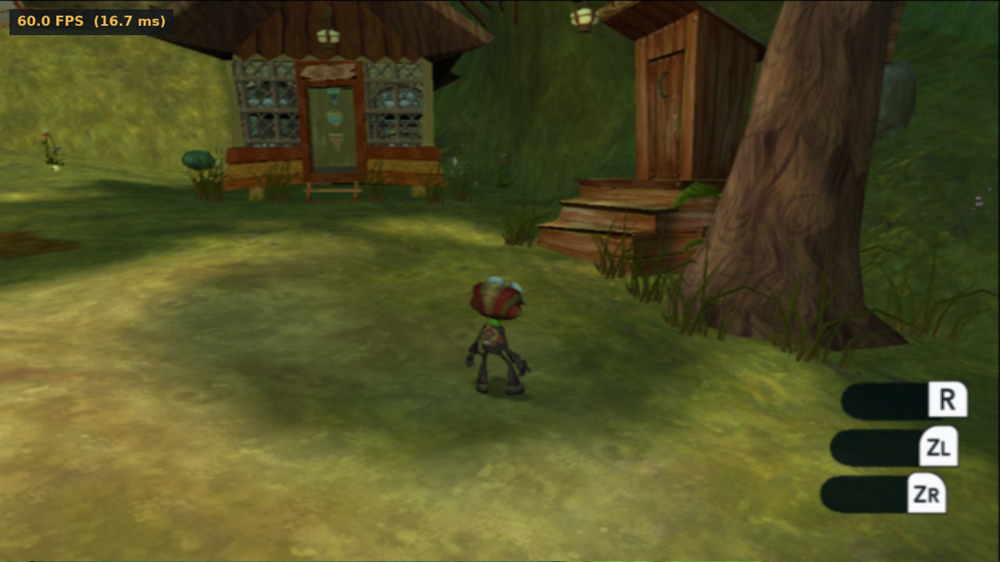
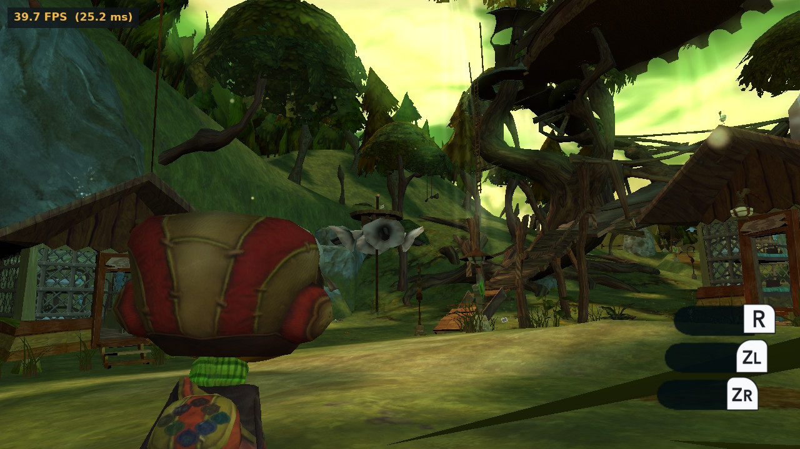

# PsychoSW

[Русский](README.ru.md) · [GitHub Releases](https://github.com/i3sey/PsychoSW/releases)

An unofficial static recompilation project targeting the original Nintendo Switch with a Steam Linux copy of Psychonauts.

## Switch features

- **Language and audio.** The launcher and quick settings support English and Russian. Game text and voice can be selected independently. With compatible local files, the launcher offers Buka's Russian dub and localized cutscenes, plus Buka or HSE/ZoG Russian text. The Steam setup below uses the original English resources. Russian localization files are supplied separately by the player.
- **Controls.** On the default layout, B jumps, Y attacks, X uses an item, L locks on, and R/ZL/ZR activate PSI powers. The launcher can swap A/B and select Switch, Xbox, or PC button prompts when the corresponding assets are available. Press X on the profile name screen to open the Switch keyboard.
- **Gyro and controller settings.** SixAxis aiming can activate on demand or also control the camera. The launcher offers axis inversion, a configurable stick deadzone, HD Rumble, and a subtitles toggle.
- **Display and graphics.** Choose a 16:9 HUD and menus or the original 4:3 layout. Auto resolution uses 720p handheld and 1080p docked, with fixed modes available. Anisotropic texture filtering has Off, 8× and 16× settings. FXAA is an optional post-processing pass that smooths edges.
- **Frame rate and quick settings.** Choose a 30 or 60 FPS cap and enable the FPS and frame-time overlay. Press **L + R + −** during gameplay to adjust common settings. The app saves settings in `RecompSettings.ini` and caches compiled shaders on the microSD card.
- **Switch runtime.** Graphics commands run on a dedicated thread. OpenAL audio pauses when the console returns to HOME or goes to sleep and resumes when the game regains focus.

## Switch performance

- **Overclocked CPU (1963.5 MHz)** — 57.6–59.6 FPS near the cabins at Whispering Rock in a handheld test. Performance varies with the camera angle and activity in the scene.
- **Stock clocks** — around 40 FPS reported. A matching capture with recorded stock clocks is still pending.



The cabin-door capture shows an instantaneous 62.7 FPS (15.9 ms) during a separate test with reduced graphics effects. Clock speeds were not recorded alongside this capture.



The heavier camp panorama shows 39.7 FPS (25.2 ms) in a separate 720p handheld run with the CPU at 1963.5 MHz.

## Release contents

The first release provides an SD preparation tool and these instructions. You need a compatible `Psychonauts.nro` from a local build and your own Steam installation. The public repository includes the ELF-to-C tool. A complete public build pipeline and a ready-to-play NRO are unavailable in this release. The lifter output alone lacks the runtime and integration work needed to build the Switch app.

## Prepare the microSD card

1. On Linux, install [Psychonauts on Steam](https://store.steampowered.com/app/3830/Psychonauts/) using the native Linux build. If you forced Proton in **Properties → Compatibility**, disable it and let Steam install the Linux files.
2. In Steam, open **Properties → Installed Files → Browse**. Find the directory with `Psychonauts` (the Linux ELF executable), `PsychonautsData2.pkg`, and `WorkResource`. Use a clean Steam installation. The expected SHA-256 of `Psychonauts` is `ec674eed6dac7045b4877dd22f36aa9088e43e58d81268c3a423273f1502d445`. On Linux, run `sha256sum "/path/to/Psychonauts/Psychonauts"` to check it.
3. Download and extract the release ZIP. Open a terminal in the extracted directory and run the following command with Python 3. Replace both input paths with your own. Choose an output directory that does not exist yet.

   ```bash
   python3 prepare_switch_sd.py --game "/path/to/Steam/steamapps/common/Psychonauts" --nro "/path/to/local/Psychonauts.nro" --output sd-card
   ```

4. Copy the generated `sd-card/switch/` folder to the root of the microSD card. If the card already has a `switch` directory, merge the folders and keep a backup of any existing Psychonauts saves before replacing files. The finished layout should look like this.

   ```text
   switch/
   ├── Psychonauts.nro
   └── psychonauts/
       ├── Psychonauts
       ├── PsychonautsData2.pkg
       └── WorkResource/
           ├── Sounds/
           └── SAVEDGAMES/
   ```

5. On a Switch already configured for homebrew, hold **R** while starting an installed title to open Homebrew Menu with full application memory. Select **Psychonauts**. The Album opens Homebrew Menu in applet mode with limited memory.
6. In the launcher select original English game text and voices. The launcher interface can use either English or Russian. Press **L + R + −** in-game for the quick settings menu. If the game fails to start, check `switch/psychonauts/recomp.log`. If sound is missing, verify that the original `.isb` files are present in `WorkResource/Sounds`.

### Russian text, voices, and cutscenes

The launcher supports two Russian text options and one Russian dub, by Buka. Text and voice settings are independent, so you can pair ZoG text with Buka voices or use Russian text with the original English voices.

1. Prepare a clean Steam Linux installation as described above. On your computer, extract each localization component into its own folder. For a Windows-only installer, apply it to a separate copy of the English PC version supported by that installer and collect the installed resources from there. Use a separate folder for each text variant so you can keep both.
   - **Buka 2006** is available in Trup's adaptation. The guide lists separate text, audio, and video components as well as a complete bundle. [Trup's Steam Community guide](https://steamcommunity.com/sharedfiles/filedetails/?id=1563292349&l=russian)
   - **Patched / HSE-ZoG** is the PsychoSW launcher label for the patched text slot. Choose **ZoG (XXI vek)** text in Rusik's installer. [Rusik's Steam Community guide](https://steamcommunity.com/sharedfiles/filedetails/?id=2199588804)
   - **Buka Russian voices** use the audio component for in-game speech and the video component or complete bundle for localized cutscenes. Buka's store lists English as the language of its current Steam key. [Trup's guide](https://steamcommunity.com/sharedfiles/filedetails/?id=1563292349&l=russian) · [Buka store listing](https://shop.buka.ru/item/psychonauts)
2. Open `switch/psychonauts/WorkResource/` on the microSD card. Copy the contents according to the table and preserve filenames and subfolders. Create the Russian directories alongside the original English resources.

   | Component | Files from the localization | Destination inside `WorkResource/` |
   | --- | --- | --- |
   | Buka text | Russian `*_StringTable*.lub` tables from `Localization/English/` or the translation's text folder | `Localization/Russian_Buka/` |
   | ZoG text | Russian `*_StringTable*.lub` tables from the installed ZoG variant | `Localization/Russian_Patched/` |
   | Buka fonts | Cyrillic files from the Buka pack's `Fonts/` folder | `Fonts_Russian_Buka/` |
   | ZoG fonts | Cyrillic files from the ZoG pack's `Fonts/` folder | `Fonts_Russian_Patched/` |
   | Buka voices | Russian `.isb` sound banks and companion files from `Sounds/` | `Sounds_Russian/` |
   | Russian cutscenes | The localized `cutscenes/` tree with `.bik` videos and any accompanying audio | `cutscenes_Russian/`, preserving the `prerendered/` subfolder |

   If your pack supplies a compatible `common_rus.ppf`, place it at `PCLevelPackFiles/common_rus.ppf`. Both Russian text options use this optional file. The port looks for standalone cutscene audio as a matching MP3, for example `cutscenes_Russian/prerendered/INTRO.mp3`.
3. Restart the port. In the launcher choose the text variant under **Game Text & Fonts** and independently select **Russian (Buka)** under **Voice & Cutscenes**. If a text option is missing, look for `GLOBAL_StringTable.lub` directly inside the corresponding `Russian_Buka` or `Russian_Patched` folder. The voice option requires `Sounds_Russian/commonvoice.isb`. If some lines or videos still play in English, check the individual files and directory layout. The port uses the original Steam file whenever a Russian replacement is missing.

## Local ELF-to-C translation

Install Python dependencies in a virtual environment with `python3 -m pip install capstone pyelftools`. Use a fresh output directory so you preserve any existing generated code and manual optimizations.

```bash
python3 tools/recomp/lift.py --elf "/path/to/Psychonauts/Psychonauts" --output /path/to/lifted-c
```

The tool targets the Linux executable revision above. The translated code is for local use. See [LICENSE](LICENSE) and [third-party notices](THIRD_PARTY.md) for the scope of the project's MIT license.
