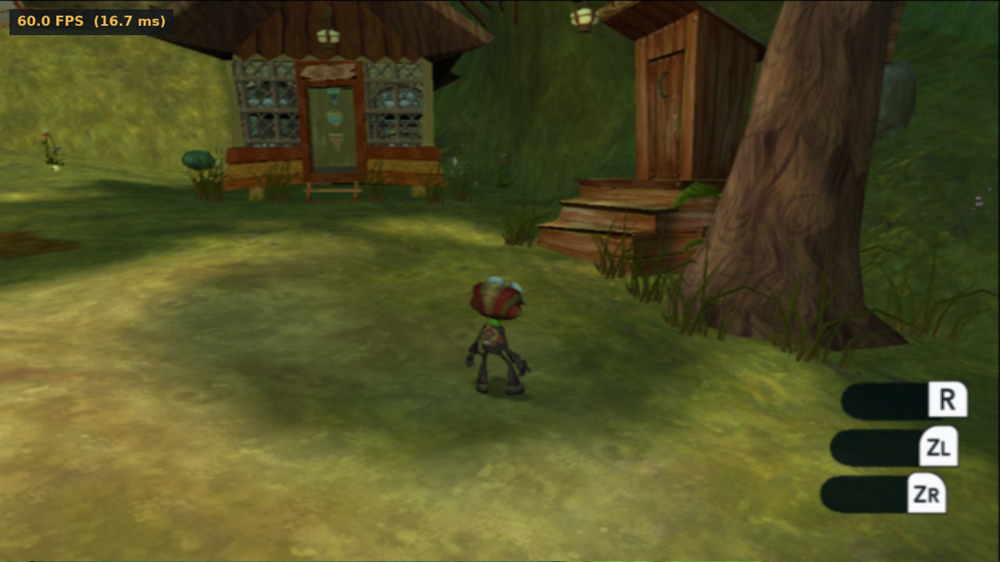
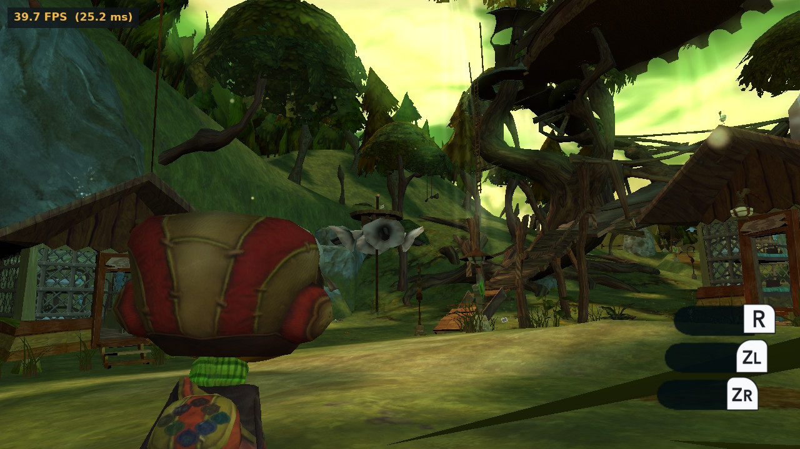

# PsychoSW

[English](README.md) · [Релизы GitHub](https://github.com/i3sey/PsychoSW/releases)

Неофициальный проект статической рекомпиляции Psychonauts для первой Nintendo Switch на основе Linux-версии игры из Steam.

## Производительность на Switch

- **С разгоном CPU до 1963,5 МГц** — 57,6–59,6 FPS у домиков в лагере Whispering Rock в портативном режиме. Частота кадров зависит от ракурса и происходящего в сцене.
- **Без разгона** — по сообщённым результатам около 40 FPS. Сопоставимого кадра с зафиксированными штатными частотами пока нет.



На кадре у домиков счётчик показывает 60,0 FPS (16,7 мс). Частоты для этого кадра отдельно не записаны.



На более тяжёлой панораме лагеря — 39,7 FPS (25,2 мс). Это отдельный прогон в портативном режиме при 720p с частотой CPU 1963,5 МГц.

## Что входит в релиз

В первом релизе есть утилита подготовки SD-карты и эта инструкция. Для запуска нужны совместимый `Psychonauts.nro` из локальной сборки и собственная установленная копия игры из Steam. В публичном репозитории есть инструмент трансляции ELF в C. Готовый NRO и полный набор исходников для его сборки пока недоступны. Выходных файлов транслятора недостаточно для сборки приложения без среды выполнения и интеграционных доработок.

## Подготовка microSD

1. Установите [Psychonauts в Steam](https://store.steampowered.com/app/3830/Psychonauts/) на Linux. Если в **Свойства → Совместимость** принудительно выбран Proton, отключите его и дайте Steam установить родную Linux-версию.
2. В Steam откройте **Свойства → Установленные файлы → Обзор**. Нужна папка, в которой лежат `Psychonauts` (исполняемый файл Linux в формате ELF), `PsychonautsData2.pkg` и `WorkResource`. Используйте чистую установку Steam. Ожидаемая SHA-256 файла `Psychonauts` — `ec674eed6dac7045b4877dd22f36aa9088e43e58d81268c3a423273f1502d445`. В Linux её можно проверить командой `sha256sum "/путь/к/Psychonauts/Psychonauts"`.
3. Скачайте и распакуйте ZIP из релиза. Откройте терминал в распакованной папке и запустите команду через Python 3, подставив свои пути к игре и NRO. В качестве папки назначения укажите новый каталог.

   ```bash
   python3 prepare_switch_sd.py --game "/путь/к/Steam/steamapps/common/Psychonauts" --nro "/путь/к/локальному/Psychonauts.nro" --output sd-card
   ```

4. Скопируйте папку `sd-card/switch/` в корень microSD. Если папка `switch` уже есть, объедините папки. Перед заменой файлов сохраните резервную копию имеющихся сохранений Psychonauts. Итоговая структура выглядит так.

   ```text
   switch/
   ├── Psychonauts.nro
   └── psychonauts/
       ├── Psychonauts
       ├── PsychonautsData2.pkg
       └── WorkResource/
           ├── Sounds/
           └── SAVEDGAMES/
   ```

5. На Switch с уже настроенным запуском homebrew удерживайте **R** при открытии установленной игры. Откроется Homebrew Menu с полным объёмом памяти приложения. Выберите **Psychonauts**. Запуск через «Альбом» открывает Homebrew Menu в режиме апплета с ограниченной памятью.
6. В лаунчере выберите оригинальные английские текст и озвучку. Интерфейс лаунчера можно переключить на русский. Для быстрых настроек в игре нажмите **L + R + −**. Если игра не запускается, проверьте `switch/psychonauts/recomp.log`. При отсутствии звука проверьте наличие оригинальных файлов `.isb` в `WorkResource/Sounds`.

## Локальная трансляция ELF в C

Установите зависимости в виртуальное окружение Python командой `python3 -m pip install capstone pyelftools`. Укажите новую выходную папку, чтобы сохранить ранее сгенерированные файлы и ручные оптимизации.

```bash
python3 tools/recomp/lift.py --elf "/путь/к/Psychonauts/Psychonauts" --output /путь/к/lifted-c
```

Инструмент рассчитан на указанную выше версию исполняемого файла Linux. Сгенерированный код предназначен для локального использования. Область действия MIT описана в [LICENSE](LICENSE) и в [уведомлении о сторонних компонентах](THIRD_PARTY.md).
